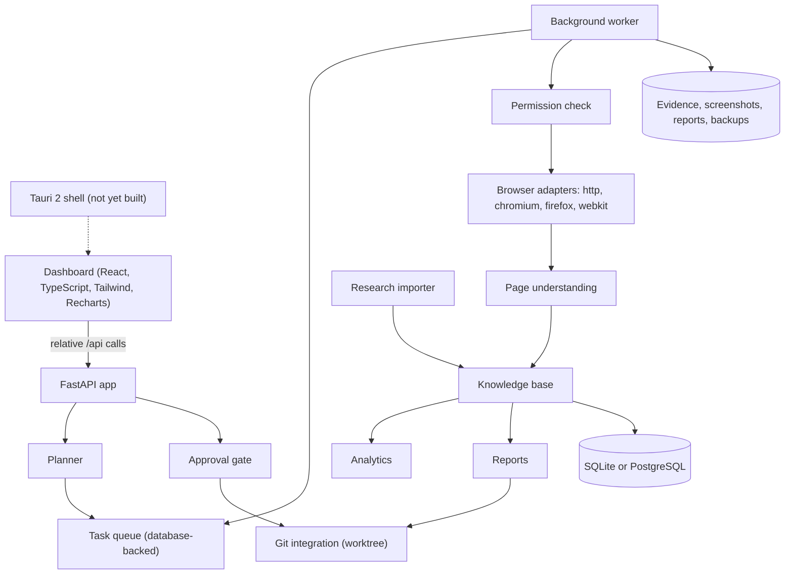

# 02 · Architecture



## Layout

```
engine/
  backend/nlie/        Python package
    app.py             HTTP API, first-run bootstrap, serves the built dashboard
    db.py              17 tables, sessions, activity log, version snapshots, backup
    jobs.py            queue, worker thread, retry, cancel, recovery, capture pipeline
    planner.py         what to do next, completeness criteria, recommendations
    permissions.py     approval, mode, scope, page limit, robots.txt
    browser/           adapter contract, HTTP adapter, Playwright adapter, registry
    understanding.py   HTML to structured page record and findings
    features.py        20 categories, 15 fields, rule-based categorisation
    knowledge.py       idempotent writes, version rules, search
    importer.py        reads docs/research into the knowledge base
    analytics.py       measures with formula and inputs
    reports.py         one structure rendered to md, json, csv, html, pdf, mmd
    github.py          read repository, doc gaps, branch/commit/push/PR
    approvals.py       human decisions before consequential actions
    ai.py              provider interface, offline provider, OpenAI-compatible provider
    visual.py          image hash and pixel comparison
    security.py        redaction of secrets
  backend/tests/       31 tests plus 3 real-browser tests that skip when no browser is installed
  frontend/            dashboard source
  desktop/             Tauri 2 configuration (unbuilt)
```

## Decisions and why

| Decision | Reason |
| --- | --- |
| Queue lives in the database, one worker thread | Survives restarts with no extra service. Tasks left "running" at start-up go back to the queue. One worker keeps per-site rate limits simple |
| Each task runs in one transaction | A failed or blocked capture leaves no half-written page, finding or evidence |
| Tasks have a unique key | Planning twice cannot queue the same capture twice |
| Sources start unapproved and manual-only | Nothing is fetched until a person agrees. Requested settings wait inside the approval |
| robots.txt unreachable or refused means stop | The cautious reading. A site with no robots.txt (404) is allowed if approved |
| Findings are fingerprinted per page | The same observation is stored once |
| Feature updates keep existing text; "verified" features are locked | Automated passes cannot overwrite a researcher's work. Every change saves the previous version |
| Evidence HTML is archived with a SHA-256 | A finding can be checked against exactly what was captured |
| Git writes happen in a temporary worktree | The user's branch and files are never switched or modified |
| Works with no language model | Planning, analysis and reports are rules. A model is an optional addition, and its output must be stored as interpretation |
| Analytics return "no data" instead of zero when there is nothing to divide by | No invented percentages |

## Data model (main tables)

`projects`, `sources`, `tasks`, `pages`, `findings`, `features`, `evidence`, `screenshots`, `questions`, `decisions`, `notes`, `reports`, `approvals`, `versions`, `activity`, `browser_profiles`, `browser_runs`.

A finding has: unique ID, page, observation, evidence, timestamp, confidence, status, related features. A feature has a name plus 14 documented fields, a category, cited evidence IDs, and a confidence equal to the weakest class among its evidence.

## Adding a browser engine

Implement `capture(request)` and `health()` from `browser/base.py`, then call `registry.register("name", Factory)`. Nothing else changes.
