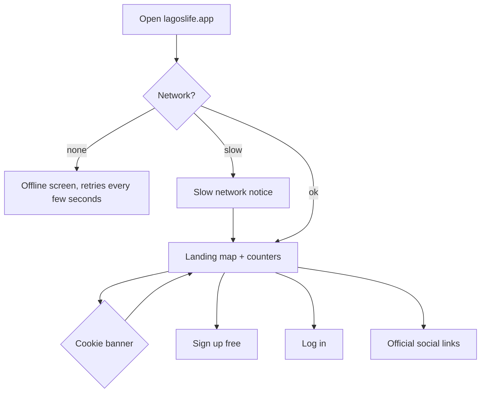
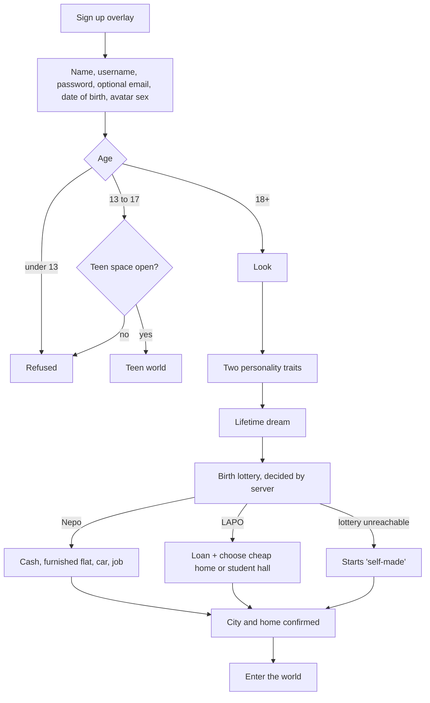
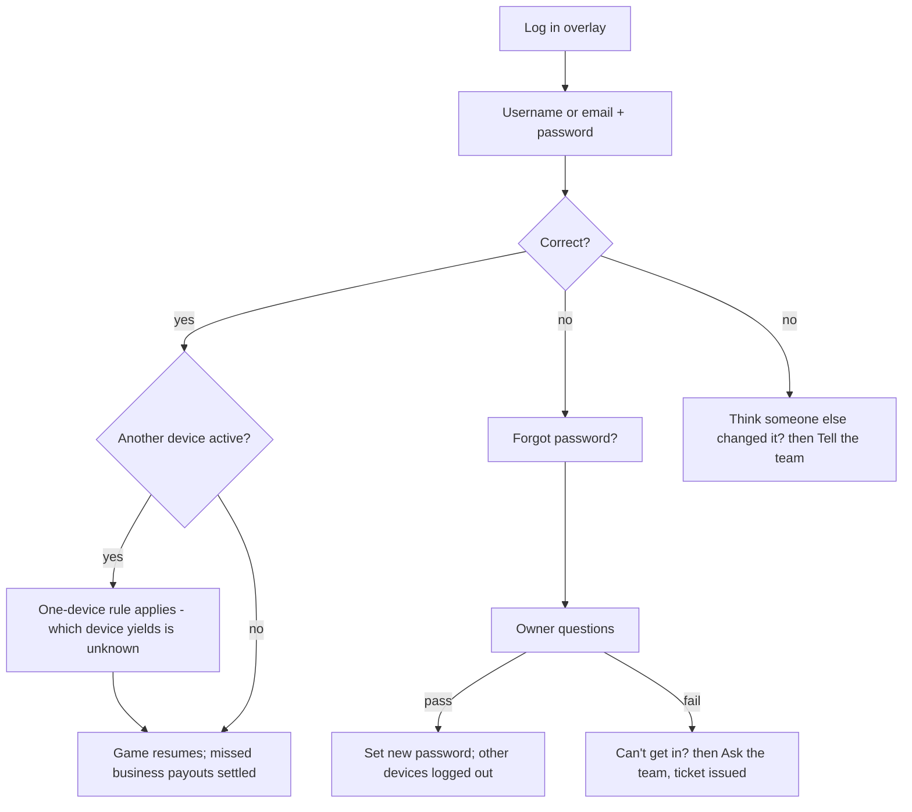
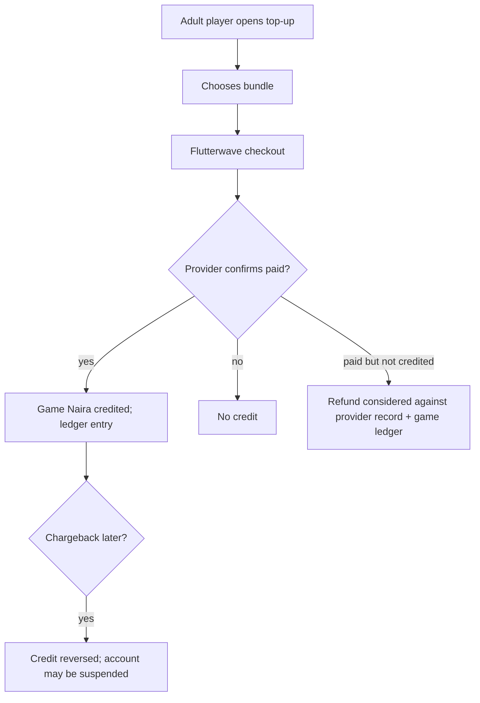
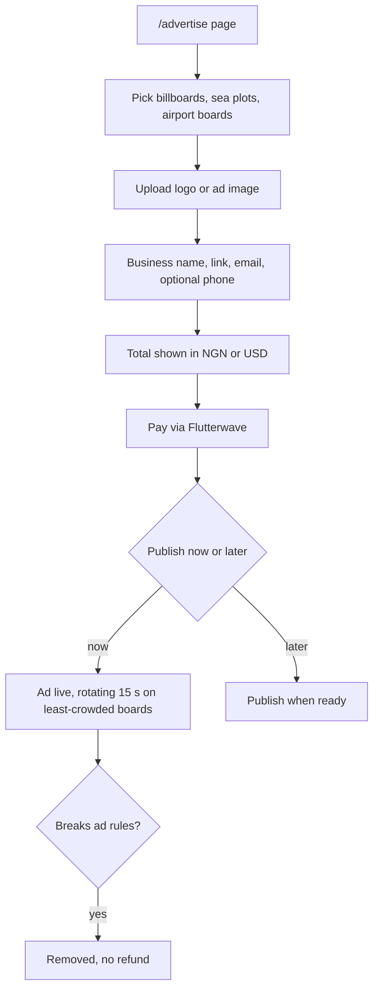
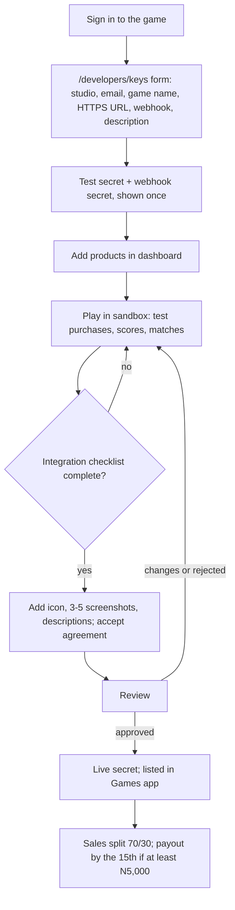
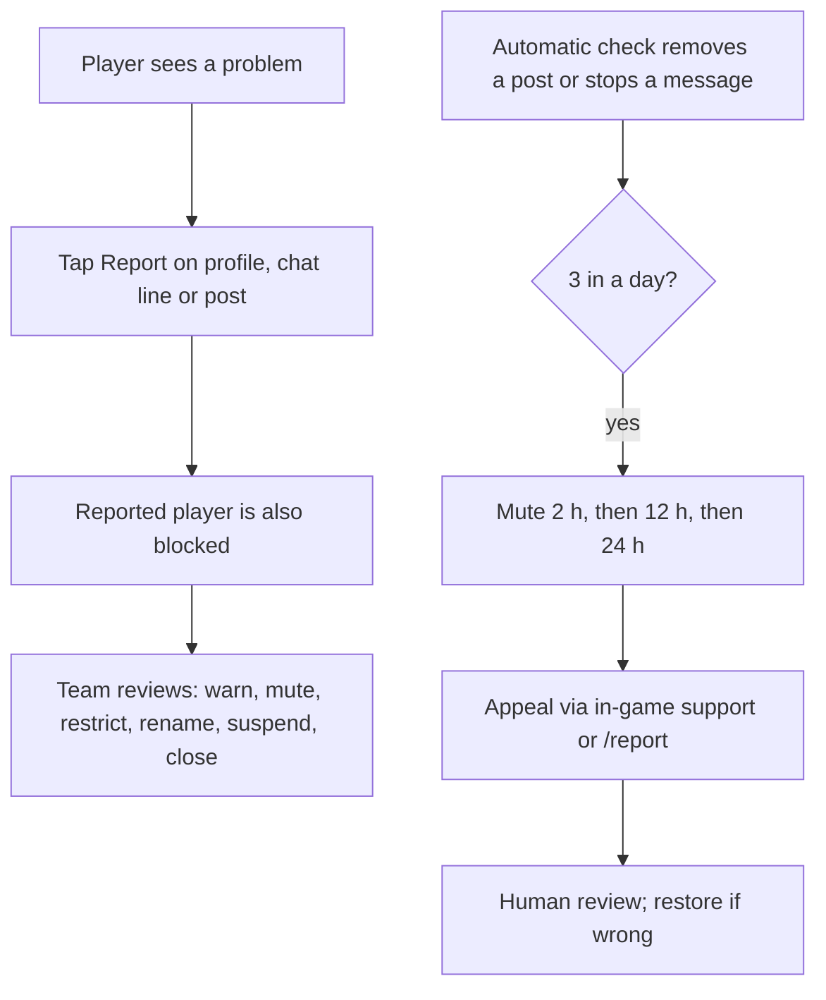

# 04 · User Journey Documentation

Journeys J1, J7, J8 and J9 are built from first-party pages (C). The others depend on secondary sources (S) and are marked. None was performed by us.

## J1 · New visitor arrives (C)

- **Start:** `https://lagoslife.app/`
- **Sees:** city map, live counters, cookie banner, "Sign up free" / "Log in".
- **Branches:** accept or limit cookies; sign up; log in; leave via a social link.
- **Failure states:** slow connection ("Slow network… still loading"); no connection (offline screen with auto-retry); unknown URL (Pidgin 404).

## J2 · Registration and Sim creation (S; fields C)

- **Inputs:** identity fields; appearance; two traits; one dream; start city (pre-selected from approximate location); home.
- **Success:** the Sim wakes at home.
- **Dependencies:** cookies must persist (in-app browsers reportedly fail).

## J3 · Returning user logs in (S; recovery C)

## J4 · Earning virtual currency through a job (S)

1. Phone → pick a career → "Apply — start tomorrow".
2. On a work day, tap "Go to work"; choose transport; arrive before the start time.
3. Choose a work mode; complete tasks (4 wins = +15%).
4. Stay to the end; pay is credited, with tax taken automatically above the weekly threshold.
5. Train the career's skill; at 100% performance and the required skill level, promotion follows.

- **Failure states:** late arrival (performance drop); leaving early (reduced pay); low needs (poor work); venue closed.

## J5 · Buying something with Game Naira (S)

- **Furniture:** at home → Buy mode → catalogue → place → confirm. Selling is available.
- **Business:** "Own a business" → pick → pay → daily 6 PM settlement.
- **Land:** buy a plot → possible "omo-onile" charge → hold → sell with 5% fee.

## J6 · Buying Game Naira with real money (C that it exists; screens not seen)

## J7 · Advertiser books a billboard (C)

## J8 · Developer ships a community game (C)

In-game purchase inside a community game: game calls `purchase(productId)` → the host shows its own pay sheet → player pays → host verifies with the payment provider → game is told → developer's server checks the purchase → delivers → marks delivered.

## J9 · Reporting, moderation and appeal (C)

## J10 · Travelling to another city (S)

Go to the airport (open 24 hours) → check-in desk → "Book a Flight" → choose cabin → optional insurance → fly → land at the destination airport. Alternative: intercity bus from the bus park, or self-drive. The home does not move; rent continues in the origin city.

## J11 · Running for governor (S)

Pay the campaign fee → write campaign text → players vote at the polling unit during the week → count at Sunday 8 PM → winner receives a daily allowance for a week and selects one policy that changes prices or pay for everyone.

## J12 · Deleting an account (C)

Phone → Settings → Account → Delete account → password → second confirmation → logged out everywhere → 30 days to undo by logging in → erased → username held 90 days.

## Journeys we could not reconstruct

Profile viewing and editing; settings screens in full; messaging UI; dating and marriage flows; betting and casino; the court; crime; partner-store checkout; university enrolment and exams.
