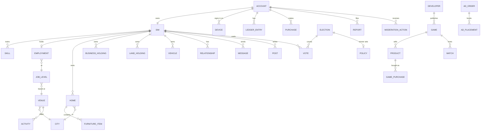

# 07 · Data and Entity Model (conceptual)

This is **our reconstruction** from public statements, not their schema. Entities marked ★ are named or directly implied on first-party pages; the rest come from secondary descriptions of gameplay. Attribute lists are indicative.

## 1. Entity catalogue

| Domain | Entity | Key attributes (observed or implied) | Source |
| --- | --- | --- | --- |
| Identity | ★ Account | user id, username, display name, email?, password hash, date of birth, status, created at, world (adult/teen) | E06, E07 |
| | ★ Device | device id, push token, last sign-in location | E07 |
| | ★ Session | token, expiry (60 days web) | E07 |
| | ★ OwnerQuestion answers | recovery answers | E07 |
| | ★ SecurityEvent | type, time, approximate location | E07 |
| Character | ★ Sim (saved game) | look, money, needs, mood, traits, dream, birth class, current place | E07, S |
| | Skill | sim, skill type, level | S |
| | Moodlet | sim, type, effect, expiry | S |
| World | City | name | S |
| | ★ Venue | city, name, opening hours, activities | E01, S |
| | Activity | venue, duration, cost, skill trained, pays? | S |
| | ★ Home | sim, city, area, type, weekly rent, size, guest cap, arrears | E13, S |
| | Furniture item | home, catalogue item, position, rotation, needs power | S |
| Work | Career / JobLevel | career, level, title, pay, skill requirement, workplace, shift days and hours | S |
| | Employment | sim, job level, performance | S |
| | Gig | formula, duration, cooldown, requirement | S |
| | Enrolment | sim, course, level, CGPA | S |
| Economy | ★ LedgerEntry | account, amount, type, counterparty, reference, time | E06, E07 |
| | ★ Transfer | sender, receiver, amount, fee, hold status | E07, S |
| | ★ Purchase (real money) | account, item, amount, currency, provider reference, status | E07 |
| | Loan | sim, principal, balance, weekly instalment | S |
| | ★ Business holding | sim, business type, purchase price | E13, S |
| | ★ Land holding | sim, plot, purchase price, current value | E13, S |
| | ★ Vehicle | sim, model | E13, S |
| | ★ Bet | sim, stake, outcome | E07 |
| | Insurance policy | sim, cover | S |
| Social | ★ Relationship | sim A, sim B, type (friend tier, family, partner, follower) | E07 |
| | ★ Block | blocker, blocked | E12 |
| | ★ Chat / Group / Message | participants, text, reactions, stickers | E07 |
| | ★ VoiceNote | message, object key, expiry (90 days) | E07 |
| | ★ VoiceRoom ("Space") | venue or home, participants, safety status | E07 |
| | ★ Post / Comment ("Gist", "Hustle") | author, text, moderation state | E07, E09 |
| Civic | ★ Election | period, candidates, votes (de-identified on deletion) | E07, S |
| | Policy | governor, type, effect, period | S |
| | ★ CourtCase | parties, record | E07 |
| | Offence / Detention | sim, type, fine, release time | S |
| Safety | ★ Report | reporter, target, reason, evidence, reference, status | E12, E14 |
| | ★ ModerationAction / Strike | account, type, duration, appeal state | E09 |
| | ★ SupportTicket | account, thread | E12 |
| Advertising | ★ AdOrder | advertiser details, image, link, payment, publish state | E15 |
| | ★ Billboard / SeaPlot | id (e.g. 201–210), location, size | E15 |
| | ★ AdStat | ad, views, taps (per ad, never per player) | E07 |
| Developer | ★ Developer / Game | studio, URL, webhook, listing, review state, keys (hashed) | E17 |
| | ★ Product | game, id, name, price ₦100–₦50,000, one-off or consumable | E17 |
| | ★ GamePurchase | id, product, player pseudonym, amount, status (paid / delivered / refunded), mode | E17 |
| | ★ Match | id, code, status, stake, seats, players, winner, pot, payout, nonce, timestamps | E17 |
| | ★ Score | game, player pseudonym, best | E17 |
| | ★ Payout | developer, month, amount | E18 |
| Partner | ★ PartnerStore / Order | merchant, items, delivery address (sealed, later removed) | E07 |

## 2. Relationship sketch

## 3. Rules that shape the data design

- One Sim per account; the birth class is fixed for the account's life (S).
- A home belongs to a city and does not follow the Sim (S).
- Ledger, votes, reports and court records survive account deletion in de-identified form (C).
- Community games see only a per-game pseudonymous player id (C).
- Test and live data never mix in the developer API (C).
- Teen data lives in a separate database (C).

## 4. Unknowns

Whether cities have separate governors and economies; item inventory beyond furniture and vehicles; clothing ownership; how shares, crypto and insurance are stored; whether businesses can be player-named or co-owned.
